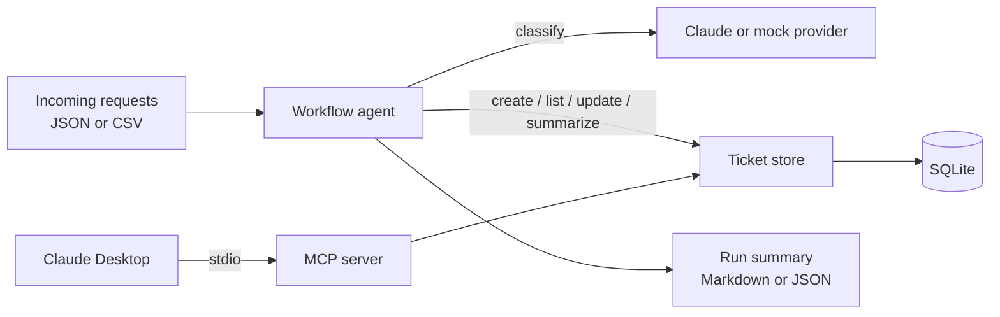

# mcp-workflow-agent

[](https://github.com/harkaransingh44-stack/mcp-workflow-agent/actions/workflows/tests.yml)

A small [Model Context Protocol](https://modelcontextprotocol.io) server that exposes a SQLite ticket tracker as tools, plus an intake agent that reads sample requests, classifies them, files tickets, and writes a summary.

The agent talks to Claude through the Anthropic API when `ANTHROPIC_API_KEY` is set. Without a key it uses a deterministic mock classifier, so the workflow and the tests run fully offline.

## What this covers

- A SQLite ticket store: create, list, get, update status, and summarize counts
- An MCP server (official Python SDK) that exposes those operations as tools over stdio
- An intake workflow that reads JSON or CSV requests, classifies them, files tickets, and writes a Markdown or JSON summary
- Retries with exponential backoff around the classifier
- Structured JSON logs on stderr
- Dry-run and mock modes so you can run the workflow without writing tickets or calling an API
- Unit tests, including in-memory MCP client calls and a flaky-provider retry test
- GitHub Actions: lint and pytest on every push and pull request

## Architecture



The MCP server and the workflow agent share the same store. Claude Desktop never needs the agent process; it calls the tools directly. The agent can run as a batch job without a desktop host.

## Quick start

```bash
git clone https://github.com/harkaransingh44-stack/mcp-workflow-agent.git
cd mcp-workflow-agent
python -m venv .venv && source .venv/bin/activate
pip install -e ".[dev]"
pytest
```

Requires Python 3.11 or newer.

Run the intake workflow in mock mode (no API key):

```bash
python -m ticketflow.agent_cli --provider mock --out reports/summary.md
```

Dry-run (classify only, do not write tickets):

```bash
python -m ticketflow.agent_cli --provider mock --dry-run --out reports/summary.md
```

Use the sample CSV instead of the JSON file:

```bash
python -m ticketflow.agent_cli --input data/incoming_requests.csv --provider mock
```

With a live Claude key:

```bash
export ANTHROPIC_API_KEY=sk-ant-...
# optional: export ANTHROPIC_MODEL=claude-sonnet-5-5
python -m ticketflow.agent_cli --provider anthropic --out reports/summary.md
```

## MCP tools

| Tool | What it does |
|------|----------------|
| `create_ticket` | Create a ticket (`title`, `body`, optional `requester`, `category`, `priority`) |
| `list_tickets` | List tickets, optionally filtered by `status`, `category`, `priority` |
| `update_status` | Set a ticket to `open`, `in_progress`, `resolved`, or `closed` |
| `summarize` | Return counts by status, priority, and category |

Category values: `access`, `billing`, `bug`, `feature`, `incident`, `other`.  
Priority values: `low`, `medium`, `high`, `urgent`.

## Connect to Claude Desktop

1. Install this project into a virtualenv as shown above.
2. Edit the Claude Desktop config file:
   - macOS: `~/Library/Application Support/Claude/claude_desktop_config.json`
   - Windows: `%APPDATA%\Claude\claude_desktop_config.json`
3. Add the server, using **absolute paths** to this repo and to the venv's Python:

```json
{
  "mcpServers": {
    "ticket-tracker": {
      "command": "/ABSOLUTE/PATH/TO/mcp-workflow-agent/.venv/bin/python",
      "args": ["-m", "ticketflow.server"],
      "cwd": "/ABSOLUTE/PATH/TO/mcp-workflow-agent",
      "env": {
        "TICKET_DB_PATH": "/ABSOLUTE/PATH/TO/mcp-workflow-agent/data/tickets.db"
      }
    }
  }
}
```

4. Restart Claude Desktop. Ask it to "create a high-priority incident ticket about the portal being down, then summarize open tickets."

Start the server yourself only when you want to confirm it boots (it will wait on stdin and print nothing):

```bash
python -m ticketflow.server
```

`TICKET_DB_PATH` defaults to `data/tickets.db` under this repo.

## Project layout

```
.
├── data/
│   ├── incoming_requests.json    # Sample inbox for the agent
│   └── incoming_requests.csv     # Same idea, CSV shape
├── src/ticketflow/
│   ├── store.py                  # SQLite backend
│   ├── server.py                 # MCP tools over stdio
│   ├── llm.py                    # Mock and Anthropic providers
│   ├── retries.py                # Backoff helper
│   ├── logging_config.py         # JSON logs
│   ├── workflow.py               # Classify → file → summarize
│   └── agent_cli.py              # Command-line entry point
├── tests/
└── .github/workflows/tests.yml
```

## Configuration

| Variable | Default | Purpose |
|----------|---------|---------|
| `TICKET_DB_PATH` | `data/tickets.db` | SQLite file used by the MCP server |
| `ANTHROPIC_API_KEY` | unset | Enables the live Claude provider |
| `ANTHROPIC_MODEL` | `claude-sonnet-5-5` | Model id for the live provider |
| `TICKETFLOW_PROVIDER` | `mock` if no key, else `anthropic` | Override provider selection |

## CI

On every push and pull request to `main`, GitHub Actions installs the package, runs `ruff`, then runs `pytest` with the mock provider. JUnit and HTML reports are uploaded as artifacts. No Anthropic key is required in CI.

## Author

**Harkaran Singh**
LinkedIn: [linkedin.com/in/harkaran-singh784](https://www.linkedin.com/in/harkaran-singh784/)

## License

MIT. See [LICENSE](LICENSE).
